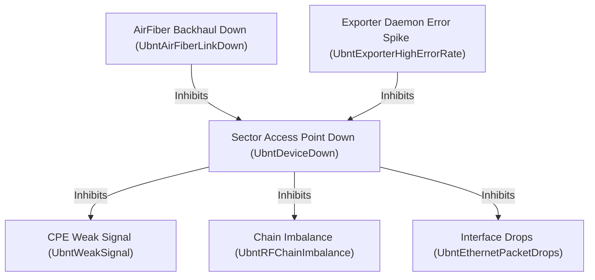

# Prometheus Integration & Exporter Guide

The `ubnt-exporter` provides native Prometheus and OpenMetrics endpoints for collecting metrics from Ubiquiti AirMAX (M/AC), LTU, and AirFiber wireless networking devices.

---

## Table of Contents

- [Overview](#overview)
- [Operational Modes](#operational-modes)
  - [Mode 1: Continuous Background Daemon (`/metrics`)](#mode-1-continuous-background-daemon-metrics)
  - [Mode 2: Multi-Target Probe (`/probe`)](#mode-2-multi-target-probe-probe)
- [Prometheus & OpenMetrics Compatibility](#prometheus--openmetrics-compatibility)
  - [OpenMetrics 2.0 Negotiation](#openmetrics-20-negotiation)
  - [Unix Domain Socket (UDS) Scraping](#unix-domain-socket-uds-scraping)
- [Prometheus Configuration Examples](#prometheus-configuration-examples)
  - [Daemon Mode Scrape Configuration](#daemon-mode-scrape-configuration)
  - [Multi-Target Probe Relabeling Configuration](#multi-target-probe-relabeling-configuration)
- [Comprehensive Metric Reference](#comprehensive-metric-reference)
  - [Device System Metrics](#device-system-metrics)
  - [Wireless Access Point Metrics](#wireless-access-point-metrics)
  - [Connected Station / Peer Metrics](#connected-station--peer-metrics)
  - [AirFiber 5XHD Metrics](#airfiber-5xhd-metrics)
  - [Network Interface Metrics](#network-interface-metrics)
  - [Exporter Internal Telemetry](#exporter-internal-telemetry)
- [Alerting & Alertmanager Integration](#alerting--alertmanager-integration)
  - [Alert Taxonomy & Labeling Standards](#alert-taxonomy--labeling-standards)
  - [Production PromQL Alert Catalog](#production-promql-alert-catalog)
  - [Hierarchical Inhibition Matrix](#hierarchical-inhibition-matrix)
  - [Slack Notification Receiver (Flapping Mitigation)](#slack-notification-receiver-flapping-mitigation)
  - [Telegram Notification Receiver (HTML Alerts)](#telegram-notification-receiver-html-alerts)
  - [DevOps Slack Receiver (Daemon Self-Health)](#devops-slack-receiver-daemon-self-health)
  - [WISP CRM & Ticketing Webhook Integration](#wisp-crm--ticketing-webhook-integration)
- [Production Deployment](#production-deployment)
  - [Systemd Service Unit](#systemd-service-unit)
  - [Docker Compose](#docker-compose)
  - [Kubernetes Manifest](#kubernetes-manifest)

> [!NOTE]
> **Consolidated Templates Directory:**
> All example configuration and alerting files are maintained in the dedicated [`examples/`](../examples/) folder:
> - [`examples/config.yaml.example`](../examples/config.yaml.example): Radio inventory and credentials.
> - [`examples/system.yaml.example`](../examples/system.yaml.example): Daemon runtime, timeouts, and logging formats.
> - [`examples/alerts.yaml.example`](../examples/alerts.yaml.example): Production Prometheus 3.15+ alert rules.
> - [`examples/alertmanager.yaml.example`](../examples/alertmanager.yaml.example): Alertmanager 0.34+ routing and templates.

---

## Overview

The exporter queries AirOS REST endpoints (`/api/v1.0/status`) on remote Ubiquiti radios, parses the JSON payload into structured metrics, caches them in zero-contention thread-safe storage, and serves them to Prometheus in standard exposition formats.

### Hardware & Transport Compatibility

The exporter communicates with target devices using HTTP or HTTPS (REST API):

- **AirMAX AC (AirOS v8), AirFiber 5XHD, and LTU Series:** Uses modern TLS 1.2/1.3 with ECDHE key exchange.
- **AirMAX M-series (AirOS v6, e.g., Rocket M5, NanoStation M5, AirGrid M5):** Fully supported via built-in negotiation of legacy RSA cipher suites (`TLS_RSA_WITH_AES_256_GCM_SHA384`, `TLS_RSA_WITH_AES_128_GCM_SHA256`, and CBC suites) with TLS 1.0+ fallback.

---

## Operational Modes

### Mode 1: Continuous Background Daemon (`/metrics`)

In daemon mode, `ubnt-exporter` runs a background worker loop:

1. Every `scrape_interval` seconds, the internal goroutine worker pool concurrently polls all devices configured in `config.yaml`.
2. Results are placed into the in-memory metric store.
3. When Prometheus sends an HTTP GET request to `/metrics`, the exporter responds immediately from memory without blocking on network I/O to remote radios.

**Best for:**

- Medium to large inventories (50 to 500+ radios).
- Decoupling Prometheus scrape timeouts from remote radio latency and slow wireless links.

### Mode 2: Multi-Target Probe (`/probe`)

Similar to the Prometheus Blackbox or SNMP exporter, multi-target mode queries individual devices on demand:

```text
GET http://exporter-host:8000/probe?target=10.0.0.1
```

The exporter immediately initiates an isolated scrape against the specified device and returns metrics directly in the HTTP response.

**Best for:**

- Dynamically discovered radio fleets managed via Prometheus Service Discovery (SD).
- Target-specific scraping intervals.

---

## Prometheus & OpenMetrics Compatibility

### OpenMetrics 2.0 Negotiation

The exporter implements HTTP content negotiation according to Prometheus and OpenMetrics standards:

- Responds with `application/openmetrics-text; version=1.0.0` or version 2.0 when requested by Prometheus via `Accept` headers.
- Emits standardized `# HELP`, `# TYPE`, and `# EOF` tokens.
- Exposes `ubnt_build_info` with software version, commit revision, and Go runtime environment.

### Unix Domain Socket (UDS) Scraping

To eliminate TCP loopback overhead when running on the same host as Prometheus, configure `system.yaml`:

```yaml
server:
  listen: "unix:///run/ubnt-exporter/metrics.sock"
```

Configure Prometheus to scrape through the Unix domain socket:

```yaml
scrape_configs:
  - job_name: "ubnt-exporter-uds"
    scrape_interval: 30s
    http_sd_configs: []
    static_configs:
      - targets: ["localhost"]
```

---

## Prometheus Configuration Examples

### Daemon Mode Scrape Configuration

```yaml
scrape_configs:
  - job_name: "ubnt-exporter"
    scrape_interval: 30s
    scrape_timeout: 10s
    metrics_path: "/metrics"
    static_configs:
      - targets: ["ubnt-exporter:8000"]
```

### Multi-Target Probe Relabeling Configuration

```yaml
scrape_configs:
  - job_name: "ubnt-probe"
    scrape_interval: 60s
    scrape_timeout: 20s
    metrics_path: "/probe"
    static_configs:
      - targets:
          - "10.0.0.1"
          - "10.0.0.2"
          - "10.0.0.3"
    relabel_configs:
      - source_labels: [__address__]
        target_label: __param_target
      - source_labels: [__param_target]
        target_label: instance
      - target_label: __address__
        replacement: "ubnt-exporter:8000"
```

---

## Comprehensive Metric Reference

All metrics are exposed with the `ubnt_` prefix.

### Device System Metrics

| Metric Name | Type | Unit | Description |
| :--- | :--- | :--- | :--- |
| `ubnt_device_static_info` | Gauge | Info | Static hardware metadata: `device_model`, `firmware`, `hostname`, `mac`, and custom user labels. Value is always `1`. |
| `ubnt_ap_cpu_usage_percent` | Gauge | Percent | Current CPU load percentage (`0` to `100`). |
| `ubnt_ap_ram_usage_percent` | Gauge | Percent | Current RAM memory consumption percentage (`0` to `100`). |
| `ubnt_ram_free_bytes` | Gauge | Bytes | Free system RAM in bytes. |
| `ubnt_ram_total_bytes` | Gauge | Bytes | Total system RAM in bytes. |
| `ubnt_ap_uptime_seconds` | Gauge | Seconds | Target radio operating system uptime in seconds. |
| `ubnt_device_power_time_seconds` | Gauge | Seconds | Device uptime since cold power-on in seconds (AirMAX & AirFiber). |
| `ubnt_af_power_time_seconds` | Gauge | Seconds | Legacy alias for cold power uptime (AirFiber). |
| `ubnt_device_gps_dimension` | Gauge | Dimension | Local GPS fix dimension (`0` = none, `2` = 2D, `3` = 3D). |
| `ubnt_device_gps_altitude_meters` | Gauge | Meters | Local GPS altitude above sea level in meters. |
| `ubnt_device_gps_satellites` | Gauge | Count | Number of GPS satellites tracked by the local device. |
| `ubnt_device_gps_dop` | Gauge | Factor | Local GPS Dilution of Precision (DOP). |
| `ubnt_device_gps_time_sync_enabled` | Gauge | State | Local GPS time synchronization enabled (`1` = true, `0` = false). |
| `ubnt_device_ntp_sync_enabled` | Gauge | State | Local NTP client time synchronization enabled (`1` = true, `0` = false). |
| `ubnt_device_ntp_last_sync_timestamp_seconds` | Gauge | Timestamp | Unix epoch timestamp in seconds of the last local NTP synchronization. |

### Wireless Access Point Metrics

| Metric Name | Type | Unit | Description |
| :--- | :--- | :--- | :--- |
| `ubnt_ap_link_state` | Gauge | State | Radio Link State (`1` = connected, `0` = disconnected). |
| `ubnt_ap_service_uptime_seconds` | Gauge | Seconds | Wireless radio service driver uptime in seconds. |
| `ubnt_ap_signal_dbm` | Gauge | dBm | Average received signal strength at the AP. |
| `ubnt_ap_noise_floor_dbm` | Gauge | dBm | RF noise floor measured at the operating channel. |
| `ubnt_ap_snr_db` | Gauge | dB | Signal-to-Noise Ratio (SNR) in dB measured at the AP. |
| `ubnt_ap_frequency_mhz` | Gauge | MHz | Center radio channel frequency in MHz. |
| `ubnt_ap_control_frequency_mhz` | Gauge | MHz | Primary control frequency in MHz. |
| `ubnt_ap_channel_width_mhz` | Gauge | MHz | Channel bandwidth in MHz (e.g. `10`, `20`, `40`, `80`, `100`). |
| `ubnt_ap_output_power_dbm` | Gauge | dBm | Conducted radio transmit power. |
| `ubnt_ap_output_power_eirp_dbm` | Gauge | dBm | Effective Isotropic Radiated Power. |
| `ubnt_connected_clients_total` | Gauge | Count | Number of active connected wireless stations/peers. |
| `ubnt_ap_dfs_status` | Gauge | State | Dynamic Frequency Selection status (`0` = normal, `1` = CAC scanning). |
| `ubnt_ap_dfs_cac_rem_seconds` | Gauge | Seconds | DFS Channel Availability Check remaining countdown timer. |
| `ubnt_ap_dfs_lockout_count` | Gauge | Count | Number of DFS frequencies locked out due to radar detection. |

### Connected Station / Peer Metrics

Station metrics include the following identification labels: `ap_name`, `ap_ip`, `peer_name`, `peer_ip`.

| Metric Name | Type | Unit | Description |
| :--- | :--- | :--- | :--- |
| `ubnt_peer_static_info` | Gauge | Info | Static station metadata: `peer_mac`, `peer_product`, `peer_model`, `peer_family`, `peer_firmware`, `peer_firmware_build`. Value is `1`. |
| `ubnt_peer_distance_meters` | Gauge | Meters | Estimated physical radio link distance in meters. |
| `ubnt_peer_uptime_seconds` | Gauge | Seconds | Duration in seconds since this station associated with the AP. |
| `ubnt_peer_power_time_seconds` | Gauge | Seconds | Station hardware uptime since cold power-on. |
| `ubnt_peer_cpu_usage` | Gauge | Percent | Station CPU utilization percentage (`0` to `100`). |
| `ubnt_peer_ram_usage` | Gauge | Percent | Station RAM memory utilization percentage (`0` to `100`). |
| `ubnt_peer_ram_free_bytes` | Gauge | Bytes | Station free RAM memory in bytes. |
| `ubnt_peer_ram_total_bytes` | Gauge | Bytes | Station total RAM memory in bytes. |
| `ubnt_peer_signal_dbm` | Gauge | dBm | Local signal strength received from the station. |
| `ubnt_peer_snr_db` | Gauge | dB | Signal-to-Noise Ratio (SNR) in dB measured locally at the AP for this station. |
| `ubnt_peer_ideal_signal_dbm` | Gauge | dBm | Theoretical ideal signal strength calculated by airOS. |
| `ubnt_peer_signal_delta_ideal_db` | Gauge | dB | Signal delta between measured and theoretical ideal signal ($S_{\text{real}} - S_{\text{ideal}}$). |
| `ubnt_peer_noise_floor_dbm` | Gauge | dBm | Local RF noise floor measured for this station's signal. |
| `ubnt_peer_signal_chain0_dbm` | Gauge | dBm | Local received signal on Chain 0 (horizontal/vertical polarity). |
| `ubnt_peer_signal_chain1_dbm` | Gauge | dBm | Local received signal on Chain 1 (opposite polarity). |
| `ubnt_peer_chain_imbalance_db` | Gauge | dB | Absolute difference between Chain 0 and Chain 1 ($\lvert C_0 - C_1 \rvert$). Values $> 5$ dB indicate antenna misalignment or physical obstructions. |
| `ubnt_peer_remote_signal_dbm` | Gauge | dBm | Signal strength reported by the remote station radio. |
| `ubnt_peer_remote_snr_db` | Gauge | dB | Signal-to-Noise Ratio (SNR) in dB reported by the remote station. |
| `ubnt_peer_remote_ideal_signal_dbm` | Gauge | dBm | Theoretical ideal signal strength calculated at the remote station. |
| `ubnt_peer_remote_signal_delta_ideal_db` | Gauge | dB | Remote signal delta between measured and theoretical ideal signal. |
| `ubnt_peer_remote_noise_floor_dbm` | Gauge | dBm | RF noise floor reported by the remote station radio. |
| `ubnt_peer_remote_signal_chain0_dbm` | Gauge | dBm | Remote received signal on Chain 0. |
| `ubnt_peer_remote_signal_chain1_dbm` | Gauge | dBm | Remote received signal on Chain 1. |
| `ubnt_peer_remote_chain_imbalance_db` | Gauge | dB | Absolute chain delta measured at the remote station. |
| `ubnt_peer_remote_antenna_gain_dbi` | Gauge | dBi | Remote antenna gain reported by station. |
| `ubnt_peer_remote_cable_loss_db` | Gauge | dB | Remote antenna cable loss in dB. |
| `ubnt_peer_gps_dimension` | Gauge | Dimension | Remote peer GPS fix dimension (`0` = none, `2` = 2D, `3` = 3D). |
| `ubnt_peer_gps_altitude_meters` | Gauge | Meters | Remote peer GPS altitude above sea level in meters. |
| `ubnt_peer_gps_satellites` | Gauge | Count | Number of GPS satellites tracked by the remote peer. |
| `ubnt_peer_gps_dop` | Gauge | Factor | Remote peer GPS Dilution of Precision (DOP). |
| `ubnt_peer_gps_time_sync_enabled` | Gauge | State | Remote peer GPS time synchronization enabled (`1` = true, `0` = false). |
| `ubnt_peer_ntp_sync_enabled` | Gauge | State | Remote peer NTP client time synchronization enabled (`1` = true, `0` = false). |
| `ubnt_peer_ntp_last_sync_timestamp_seconds` | Gauge | Timestamp | Unix epoch timestamp in seconds of the last remote peer NTP synchronization. |
| `ubnt_peer_mcs_tx_index` | Gauge | Index | Modulation and Coding Scheme (MCS) index used for transmission. |
| `ubnt_peer_mcs_rx_index` | Gauge | Index | MCS index used for reception. |
| `ubnt_peer_mcs_ideal_tx_index` | Gauge | Index | Theoretical ideal MCS index for transmission. |
| `ubnt_peer_mcs_ideal_rx_index` | Gauge | Index | Theoretical ideal MCS index for reception. |
| `ubnt_peer_mcs_rate_tx` | Gauge | Multiplier | Transmit modulation rate multiplier (e.g. `6` for 64QAM). |
| `ubnt_peer_mcs_rate_rx` | Gauge | Multiplier | Receive modulation rate multiplier (e.g. `6` for 64QAM). |
| `ubnt_peer_airtime_dl_percent` | Gauge | Percent | Airtime usage percentage for downlink. |
| `ubnt_peer_airtime_ul_percent` | Gauge | Percent | Airtime usage percentage for uplink. |
| `ubnt_peer_cinr_dl_db` | Gauge | dB | Carrier to Interference-plus-Noise Ratio (downlink). |
| `ubnt_peer_cinr_ul_db` | Gauge | dB | Carrier to Interference-plus-Noise Ratio (uplink). |
| `ubnt_peer_capacity_dl_mbps` | Gauge | Mbps | Estimated downlink channel throughput capacity in Mbps. |
| `ubnt_peer_capacity_ul_mbps` | Gauge | Mbps | Estimated uplink channel throughput capacity in Mbps. |
| `ubnt_peer_capacity_combined_mbps` | Gauge | Mbps | Total combined DL+UL radio throughput capacity in Mbps. |
| `ubnt_peer_capacity_combined_ideal_mbps` | Gauge | Mbps | Total theoretical ideal DL+UL capacity in Mbps. |
| `ubnt_peer_tx_rate_mbps` | Gauge | Mbps | Instantaneous negotiated physical transmission data rate in Mbps. |
| `ubnt_peer_rx_rate_mbps` | Gauge | Mbps | Instantaneous negotiated physical reception data rate in Mbps. |
| `ubnt_peer_rx_bytes_total` | Counter | Bytes | Cumulative octets received from the station. |
| `ubnt_peer_tx_bytes_total` | Counter | Bytes | Cumulative octets transmitted to the station. |
| `ubnt_peer_rx_packets_total` | Counter | Packets | Cumulative packets received from the station. |
| `ubnt_peer_tx_packets_total` | Counter | Packets | Cumulative packets transmitted to the station. |
| `ubnt_peer_rx_pps` | Gauge | PPS | Instantaneous packet reception rate from the station. |
| `ubnt_peer_tx_pps` | Gauge | PPS | Instantaneous packet transmission rate to the station. |

### AirFiber 5XHD Metrics

| Metric Name | Type | Unit | Description |
| :--- | :--- | :--- | :--- |
| `ubnt_af_temperature_celsius` | Gauge | °C | Internal chassis operating temperature. |
| `ubnt_af_gps_satellites` | Gauge | Count | Number of GPS satellites currently tracked. |
| `ubnt_af_gps_dop` | Gauge | Factor | GPS Dilution of Precision (lower values indicate higher precision). |
| `ubnt_af_gps_altitude_meters` | Gauge | Meters | Radio antenna elevation above sea level in meters. |
| `ubnt_af_frequency_tx_mhz` | Gauge | MHz | Configured transmit frequency for split-frequency operation. |
| `ubnt_af_frequency_rx_mhz` | Gauge | MHz | Configured receive frequency for split-frequency operation. |
| `ubnt_af_frame_length_ms` | Gauge | ms | TDD radio frame duration in milliseconds (e.g. `2.0`, `2.5`, `5.0`). |
| `ubnt_af_gps_sync_status` | Gauge | State | GPS TDD synchronization status (`1` = synchronized, `0` = free-run). |
| `ubnt_af_local_autopower_state` | Gauge | Flag | Automatic power control active (`1` = enabled, `0` = disabled). |
| `ubnt_af_duty_cycle_dl_percent` | Gauge | Percent | TDD downlink/uplink split ratio percentage (e.g. `50`, `67`, `75`). |
| `ubnt_af_rx_efficiency_percent` | Gauge | Percent | Realized radio frame reception efficiency percentage. |
| `ubnt_af_dfs_blocked_status` | Gauge | State | Dynamic Frequency Selection status (`0` = normal, `1` = CAC scanning). |
| `ubnt_af_dfs_cac_remaining_seconds` | Gauge | Seconds | Channel Availability Check (CAC) countdown timer in seconds. |
| `ubnt_af_dfs_lockout_total` | Gauge | Count | Number of frequency channels currently locked out due to radar detection. |
| `ubnt_af_service_uptime_seconds` | Gauge | Seconds | Wireless radio service uptime in seconds. |
| `ubnt_af_link_state` | Gauge | State | Radio Link State (`1` = connected, `0` = disconnected). |
| `ubnt_af_channel_width_rx_mhz` | Gauge | MHz | Receive channel width in MHz (split-bandwidth). |
| `ubnt_af_signal_delta_ideal_db` | Gauge | dB | Signal delta between measured and theoretical ideal signal ($S_{\text{real}} - S_{\text{ideal}}$). |
| `ubnt_af_capacity_combined_bps` | Gauge | bps | Total combined DL+UL radio throughput capacity in bits per second. |
| `ubnt_af_capacity_combined_ideal_bps` | Gauge | bps | Total combined theoretical ideal DL+UL capacity in bits per second. |
| `ubnt_af_remote_gps_sync_status` | Gauge | State | Remote peer radio GPS synchronization status (`1` = synchronized, `0` = no sync). |
| `ubnt_af_remote_ideal_signal_dbm` | Gauge | dBm | Theoretical ideal signal strength calculated at the remote peer radio. |

### Network Interface Metrics

All interface metrics include the `interface` label (e.g. `eth0`, `eth1`, `ath0`, `ath0/0`, `ath0.99`). In addition, `ubnt_iface_info` exposes `interface_type` (`ethernet`, `wireless`, `bridge`, `vlan`), `parent_interface` (e.g. `ath0` for `ath0.99` or `ath0/0`), and `vlan_id` (e.g. `99` for `ath0.99`).

| Metric Name | Type | Unit | Description |
| :--- | :--- | :--- | :--- |
| `ubnt_iface_info` | Gauge | Info | Interface metadata: `interface`, `interface_name`, `mac`, `interface_type`, `parent_interface`, `vlan_id`. Value is `1`. |
| `ubnt_iface_rx_bytes_total` | Counter | Bytes | Total bytes received on the interface. |
| `ubnt_iface_tx_bytes_total` | Counter | Bytes | Total bytes transmitted on the interface. |
| `ubnt_iface_rx_packets_total` | Counter | Packets | Total packets received. |
| `ubnt_iface_tx_packets_total` | Counter | Packets | Total packets transmitted. |
| `ubnt_iface_rx_errors_total` | Counter | Packets | Total input packet errors (CRC, frame alignment). |
| `ubnt_iface_tx_errors_total` | Counter | Packets | Total output packet errors. |
| `ubnt_iface_rx_drops_total` | Counter | Packets | Total dropped input packets due to buffer exhaustion. |
| `ubnt_iface_tx_drops_total` | Counter | Packets | Total dropped output packets. |
| `ubnt_iface_rx_rate_bps` | Gauge | bps | Real-time reception bandwidth in bits per second. |
| `ubnt_iface_tx_rate_bps` | Gauge | bps | Real-time transmission bandwidth in bits per second. |

### Exporter Internal Telemetry

The exporter exposes detailed self-observability and internal telemetry metrics adhering to Prometheus and OpenMetrics standards:

| Metric Name | Type | Unit | Description |
| :--- | :--- | :--- | :--- |
| `ubnt_build_info` | Gauge | Info | Exporter software version, git revision, and compiler runtime info. |
| `ubnt_scrape_duration_seconds` | Summary | Seconds | Scrape duration per target device (`name`, `ip`). |
| `ubnt_exporter_collector_duration_seconds` | Histogram | Seconds | Execution latency histogram of individual collector modules (`system`, `interfaces`, `wireless`, `airfiber`, `peers`). |
| `ubnt_exporter_collector_success` | Gauge | State | Success status of the last collector execution (`1` = success, `0` = failure/panic recovered). |
| `ubnt_exporter_collector_executions_total` | Counter | Count | Total module executions broken down by `collector` and `status` (`success`, `error`). |
| `ubnt_exporter_scrape_requests_total` | Counter | Count | Total target device scrape attempts partitioned by result `status` (`success`, `timeout`, `conn_error`, `auth_error`, `http_error`, `decode_error`). |
| `ubnt_exporter_scrape_cycle_duration_seconds` | Gauge | Seconds | Wall-clock execution time of the most recent inventory scrape cycle. |
| `ubnt_exporter_last_scrape_timestamp_seconds` | Gauge | Timestamp | Unix epoch timestamp of the most recent completed scrape cycle. |
| `ubnt_exporter_devices_configured_total` | Gauge | Count | Total number of Ubiquiti devices declared in `config.yaml`. |
| `ubnt_exporter_devices_online_total` | Gauge | Count | Count of devices responding successfully in the current scrape cycle. |
| `go_*` / `process_*` | Various | Various | Standard Go runtime and process metrics (memory allocations, goroutines, GC latency, CPU seconds, open file descriptors). |

#### Exporter Operational PromQL Queries

```promql
# Overall device availability ratio across the fleet
ubnt_exporter_devices_online_total / ubnt_exporter_devices_configured_total * 100

# Scrape failure rate by error reason
sum by (status) (rate(ubnt_exporter_scrape_requests_total[5m]))

# Collector 95th percentile execution latency
histogram_quantile(0.95, sum by (le, collector) (rate(ubnt_exporter_collector_duration_seconds_bucket[5m])))

# Exporter memory consumption (resident set size)
process_resident_memory_bytes
```

## Alerting & Alertmanager Integration

The `ubnt-exporter` is designed to operate seamlessly with Prometheus Alertmanager v0.31 through v0.34+. In wireless internet service provider (WISP) and telecom deployments, monitoring radio links requires sophisticated alert routing, deduplication, and suppression to combat two major operational challenges:

1. **Alert Storming:** A single power outage or backhaul link failure on a communications tower can cause dozens of sector access points and hundreds of customer CPE stations to disconnect simultaneously.
2. **Link Flapping:** Weather phenomena (such as heavy rain fade on 5 GHz, 11 GHz, or 60 GHz links) or transient RF interference cause wireless metrics to oscillate across alert thresholds, repeatedly triggering and resolving alert notifications.

### Alert Taxonomy & Labeling Standards

All Prometheus alerting rules follow a standardized taxonomy:

| Label / Annotation | Format | Purpose |
| :--- | :--- | :--- |
| `severity` | `critical`, `warning`, `info` | Determines notification priority, escalation policies, and paging channels. |
| `target_type` | `access_point`, `backhaul_airfiber`, `cpe_station`, `daemon_internal` | Identifies the physical device layer to enable granular routing trees. |
| `inhibit_group` | String (`name`, `tower`, or `instance`) | The correlation key used by Alertmanager `inhibit_rules` to suppress downstream symptoms. |
| `runbook_url` | Relative link to documentation | Direct link to procedural remediation steps in [Operational Diagnostics](diagnostics.md). |
| `summary` | Concise string | Single-line notification header for chat applications and SMS. |
| `description` | Formatted multi-line text | Detailed diagnostic narrative including exact measurements and thresholds. |

---

### Production PromQL Alert Catalog

A complete rules configuration is available in [`examples/alerts.yaml.example`](../examples/alerts.yaml.example).

```yaml
groups:
  # -------------------------------------------------------------------------
  # 1. Physical Radio & Infrastructure Connectivity Alerts
  # -------------------------------------------------------------------------
  - name: ubnt_infrastructure_alerts
    rules:
      - alert: UbntDeviceDown
        expr: ubnt_scrape_success == 0
        for: 2m
        labels:
          severity: critical
          target_type: access_point
          inhibit_group: "{{ $labels.name }}"
        annotations:
          summary: "Ubiquiti radio offline: {{ $labels.name }}"
          description: "Target radio {{ $labels.name }} ({{ $labels.ip }}) has been unreachable for more than 2 minutes."
          runbook_url: "docs/diagnostics.md#troubleshooting-common-airos-quirks"

      - alert: UbntAirFiberLinkDown
        expr: ubnt_af_link_state == 0
        for: 1m
        labels:
          severity: critical
          target_type: backhaul_airfiber
          inhibit_group: "{{ $labels.tower }}"
        annotations:
          summary: "AirFiber backhaul link down on {{ $labels.name }}"
          description: "AirFiber 5XHD radio {{ $labels.name }} on tower {{ $labels.tower }} has lost RF link connectivity (linkState = disconnected)."
          runbook_url: "docs/diagnostics.md#airfiber-diagnostic-audits"

  # -------------------------------------------------------------------------
  # 2. Wireless Radiofrequency (RF) Health & Performance Alerts
  # -------------------------------------------------------------------------
  - name: ubnt_wireless_rf_alerts
    rules:
      - alert: UbntRFChainImbalance
        expr: ubnt_peer_chain_imbalance_db > 5
        for: 15m
        labels:
          severity: warning
          target_type: cpe_station
          inhibit_group: "{{ $labels.ap_name }}"
        annotations:
          summary: "High RF chain imbalance on {{ $labels.peer_name }}"
          description: "Polarization delta between Chain 0 and Chain 1 is {{ $value | printf \"%.1f\" }} dB on client {{ $labels.peer_name }} connected to {{ $labels.ap_name }}."
          runbook_url: "docs/diagnostics.md#detecting-rf-chain-imbalance"

      - alert: UbntWeakSignal
        expr: ubnt_peer_signal_dbm <= -75
        for: 10m
        labels:
          severity: warning
          target_type: cpe_station
          inhibit_group: "{{ $labels.ap_name }}"
        annotations:
          summary: "Weak RF signal on {{ $labels.peer_name }}"
          description: "Received signal level is {{ $value | printf \"%.1f\" }} dBm (threshold: -75 dBm) on client {{ $labels.peer_name }}."
          runbook_url: "docs/diagnostics.md#station-health--signal-auditing"

      - alert: UbntHighNoiseFloor
        expr: ubnt_ap_noise_floor_dbm >= -82
        for: 10m
        labels:
          severity: warning
          target_type: access_point
          inhibit_group: "{{ $labels.name }}"
        annotations:
          summary: "Severe RF spectrum interference on {{ $labels.name }}"
          description: "Noise floor on {{ $labels.name }} has risen to {{ $value | printf \"%.1f\" }} dBm, indicating co-channel interference or high spectral congestion."
          runbook_url: "docs/diagnostics.md#station-health--signal-auditing"

      - alert: UbntAirFiberGPSSyncLost
        expr: ubnt_af_gps_sync_status == 0
        for: 5m
        labels:
          severity: critical
          target_type: backhaul_airfiber
          inhibit_group: "{{ $labels.tower }}"
        annotations:
          summary: "AirFiber GPS sync lost on {{ $labels.name }}"
          description: "AirFiber radio {{ $labels.name }} on tower {{ $labels.tower }} has lost GPS satellite synchronization. Operating in unsynchronized free-run mode."
          runbook_url: "docs/diagnostics.md#airfiber-diagnostic-audits"

      - alert: UbntAirFiberDFSBlocked
        expr: ubnt_af_dfs_blocked_status == 1
        for: 1m
        labels:
          severity: warning
          target_type: backhaul_airfiber
          inhibit_group: "{{ $labels.name }}"
        annotations:
          summary: "AirFiber DFS CAC radar scan active on {{ $labels.name }}"
          description: "DFS radar event detected on {{ $labels.name }}. Radio is scanning channel availability with CAC countdown active."
          runbook_url: "docs/diagnostics.md#dfs-radar-cac-and-lockout-timers"

  # -------------------------------------------------------------------------
  # 3. Target Hardware & Subsystem Alerts
  # -------------------------------------------------------------------------
  - name: ubnt_hardware_interface_alerts
    rules:
      - alert: UbntHighCPULoad
        expr: ubnt_ap_cpu_usage_percent > 90
        for: 10m
        labels:
          severity: warning
          target_type: access_point
          inhibit_group: "{{ $labels.name }}"
        annotations:
          summary: "High CPU utilization on {{ $labels.name }}"
          description: "CPU load on radio {{ $labels.name }} has exceeded 90% (current: {{ $value | printf \"%.1f\" }}%)."
          runbook_url: "docs/diagnostics.md#live-terminal-diagnostics-diag"

      - alert: UbntEthernetPacketDrops
        expr: rate(ubnt_iface_rx_drops_total[5m]) > 50
        for: 5m
        labels:
          severity: warning
          target_type: access_point
          inhibit_group: "{{ $labels.name }}"
        annotations:
          summary: "Ethernet packet drops on {{ $labels.name }} ({{ $labels.interface }})"
          description: "Interface {{ $labels.interface }} on {{ $labels.name }} is dropping {{ $value | printf \"%.1f\" }} packets/sec due to queue buffer exhaustion."
          runbook_url: "docs/diagnostics.md#detecting-degraded-ethernet-ports"

      - alert: UbntAirFiberHighTemperature
        expr: ubnt_af_temperature_celsius > 75
        for: 15m
        labels:
          severity: warning
          target_type: backhaul_airfiber
          inhibit_group: "{{ $labels.name }}"
        annotations:
          summary: "AirFiber radio temperature high on {{ $labels.name }}"
          description: "Internal core temperature on AirFiber 5XHD {{ $labels.name }} is {{ $value | printf \"%.1f\" }} C (threshold: 75 C)."
          runbook_url: "docs/diagnostics.md#airfiber-diagnostic-audits"

  # -------------------------------------------------------------------------
  # 4. Exporter Daemon Operational Telemetry Alerts
  # -------------------------------------------------------------------------
  - name: ubnt_exporter_alerts
    rules:
      - alert: UbntExporterCollectorFailing
        expr: ubnt_exporter_collector_success == 0
        for: 3m
        labels:
          severity: critical
          target_type: daemon_internal
          inhibit_group: "{{ $labels.instance }}"
        annotations:
          summary: "Collector module failure: {{ $labels.collector }}"
          description: "The '{{ $labels.collector }}' collector module in ubnt-exporter has failed or encountered a recovered panic."
          runbook_url: "docs/exporter.md#exporter-internal-telemetry"

      - alert: UbntExporterHighErrorRate
        expr: sum(rate(ubnt_exporter_scrape_requests_total{status!="success"}[5m])) / sum(rate(ubnt_exporter_scrape_requests_total[5m])) * 100 > 15
        for: 5m
        labels:
          severity: warning
          target_type: daemon_internal
          inhibit_group: "{{ $labels.instance }}"
        annotations:
          summary: "Elevated scrape failure rate on ubnt-exporter"
          description: "Scrape failure rate is {{ $value | printf \"%.1f\" }}% over the last 5 minutes (threshold: 15%). Check target credentials and network reachability."
          runbook_url: "docs/exporter.md#exporter-internal-telemetry"

      - alert: UbntExporterLowFleetAvailability
        expr: (ubnt_exporter_devices_online_total / ubnt_exporter_devices_configured_total) * 100 < 80
        for: 10m
        labels:
          severity: warning
          target_type: daemon_internal
          inhibit_group: "{{ $labels.instance }}"
        annotations:
          summary: "Ubiquiti fleet availability degradation"
          description: "Online device availability has dropped to {{ $value | printf \"%.1f\" }}% (fewer than 80% of configured radios are online)."
          runbook_url: "docs/exporter.md#exporter-internal-telemetry"

      - alert: UbntExporterScrapeDurationHigh
        expr: ubnt_exporter_scrape_cycle_duration_seconds > 25
        for: 10m
        labels:
          severity: warning
          target_type: daemon_internal
          inhibit_group: "{{ $labels.instance }}"
        annotations:
          summary: "Scrape cycle execution time high on ubnt-exporter"
          description: "Global inventory scrape duration is {{ $value | printf \"%.2f\" }}s, approaching the scrape interval. Increase max_workers or tune timeouts in system.yaml."
          runbook_url: "docs/configuration.md#the-performance-section"
```

---

### Hierarchical Inhibition Matrix

Alertmanager evaluates `inhibit_rules` to prevent redundant symptom alerts when root causes fire. Alertmanager v0.34 fixes edge-case race conditions where muted alerts could spuriously reactivate, and its `eventrecorder` tracks rule names in `inhibition_muted_alert` logs.



#### Inhibition Rules in Alertmanager

```yaml
inhibit_rules:
  # 1. Access Point offline suppresses downstream station RF symptom alerts
  - source_match:
      alertname: "UbntDeviceDown"
    target_match_re:
      alertname: "UbntWeakSignal|UbntRFChainImbalance|UbntHighNoiseFloor"
    equal: ["inhibit_group"]

  # 2. Backhaul link down suppresses all dependent radio alerts on that tower
  - source_match:
      alertname: "UbntAirFiberLinkDown"
    target_match_re:
      alertname: "UbntDeviceDown|UbntWeakSignal|UbntRFChainImbalance"
    equal: ["tower"]

  # 3. Exporter daemon reachability failure suppresses individual device offline alerts
  - source_match:
      alertname: "UbntExporterHighErrorRate"
    target_match:
      alertname: "UbntDeviceDown"
    equal: ["instance"]
```

---

### Slack Notification Receiver (Flapping Mitigation)

In Alertmanager v0.32+, enabling `edit_existing_messages: true` prevents message spam when wireless links experience transient rain fade or RF fluctuations. Rather than emitting new chat notifications on each state transition, Alertmanager modifies the existing message thread in place.

```yaml
receivers:
  - name: "slack-wireless-noc"
    slack_configs:
      - channel: "#noc-wireless-alerts"
        send_resolved: true
        edit_existing_messages: true
        icon_emoji: ""
        title: |-
          [{{ .Status | toUpper }}{{ if eq .Status "firing" }}:{{ .Alerts.Firing | len }}{{ end }}] {{ .CommonLabels.alertname }} (Tower: {{ .CommonLabels.tower | default "N/A" }})
        text: |-
          {{ range .Alerts }}
          *Device:* `{{ .Labels.name | default .Labels.peer_name }}` (IP: {{ .Labels.ip | default .Labels.peer_ip }})
          *Severity:* `{{ .Labels.severity | toUpper }}`
          *Description:* {{ .Annotations.description }}
          {{ if .Annotations.runbook_url }}*Runbook:* <{{ .Annotations.runbook_url }}|Diagnostics Guide>{{ end }}
          {{ end }}
        color: |-
          {{ if eq .Status "resolved" }}#00B300{{ else if eq .CommonLabels.severity "critical" }}#D60000{{ else }}#E6522C{{ end }}
```

---

### Telegram Notification Receiver (HTML Alerts)

Alertmanager v0.31+ supports global bot tokens (`telegram_api_url`) and formatted HTML messages:

```yaml
receivers:
  - name: "telegram-critical-noc"
    telegram_configs:
      # bot_token_file: "/etc/alertmanager/secrets/telegram_bot_token"
      - bot_token: "REPLACE_WITH_TELEGRAM_BOT_TOKEN"
        chat_id: -1001234567890
        send_resolved: true
        parse_mode: "HTML"
        message: |-
          <b>[{{ .Status | toUpper }}] Ubiquiti Network Alert</b>
          <b>Rule:</b> {{ .CommonLabels.alertname }}
          <b>Severity:</b> {{ .CommonLabels.severity | toUpper }}
          <b>Tower:</b> {{ .CommonLabels.tower | default "N/A" }}
          
          {{ range .Alerts }}
          <b>Target:</b> <code>{{ .Labels.name }}</code> ({{ .Labels.ip }})
          <b>Detail:</b> {{ .Annotations.description }}
          {{ if .Annotations.runbook_url }}<b>Action:</b> <a href="{{ .Annotations.runbook_url }}">Open Diagnostics Runbook</a>{{ end }}
          {{ end }}
```

---

### DevOps Slack Receiver (Daemon Self-Health)

Internal telemetry and collector errors can be dispatched directly to your site reliability engineering (SRE) or DevOps team:

```yaml
receivers:
  - name: "slack-devops"
    slack_configs:
      - channel: "#monitoring-sre"
        send_resolved: true
        edit_existing_messages: true
        title: |-
          [EXPORTER {{ .Status | toUpper }}] {{ .CommonLabels.alertname }}
        text: |-
          {{ range .Alerts }}
          *Component:* `{{ .Labels.collector | default "daemon" }}`
          *Summary:* {{ .Annotations.summary }}
          *Description:* {{ .Annotations.description }}
          *Instance:* `{{ .Labels.instance }}`
          {{ end }}
        color: |-
          {{ if eq .Status "resolved" }}#00B300{{ else }}#D60000{{ end }}
```

---

### WISP CRM & Ticketing Webhook Integration

Using Alertmanager v0.32+ payload templating, notifications can be delivered directly to WISP customer relationship management (CRM) and billing APIs (e.g. Splynx, Sonar, UISP, or custom ticketing) without an intermediate conversion webhook:

```yaml
receivers:
  - name: "wisp-ticketing-webhook"
    webhook_configs:
      - url: "https://crm.wisp-domain.net/api/v1/network-alerts"
        send_resolved: true
        http_config:
          # credentials_file: "/etc/alertmanager/secrets/wisp_crm_token"
          bearer_token: "REPLACE_WITH_WISP_CRM_TOKEN"
```

A complete configuration template is provided in [`examples/alertmanager.yaml.example`](../examples/alertmanager.yaml.example).

---

## Production Deployment

### Systemd Service Unit

Create `/etc/systemd/system/ubnt-exporter.service`:

```ini
[Unit]
Description=Ubiquiti AirMAX and AirFiber Prometheus Exporter
After=network.target network-online.target
Wants=network-online.target

[Service]
Type=simple
User=ubnt-exporter
Group=ubnt-exporter
WorkingDirectory=/etc/ubnt-exporter
ExecStart=/usr/local/bin/ubnt-exporter --cfg-dir /etc/ubnt-exporter run
ExecReload=/bin/kill -HUP $MAINPID
Restart=always
RestartSec=5s

# Security Hardening
ProtectSystem=strict
ProtectHome=true
NoNewPrivileges=true
PrivateTmp=true

[Install]
WantedBy=multi-user.target
```

Enable and start the service:

```bash
sudo systemctl daemon-reload
sudo systemctl enable --now ubnt-exporter
```

### Docker Compose

```yaml
services:
  ubnt-exporter:
    image: ubnt-exporter:latest
    container_name: ubnt-exporter
    restart: unless-stopped
    ports:
      - "8000:8000"
    volumes:
      - ./config.yaml:/app/config.yaml:ro
      - ./system.yaml:/app/system.yaml:ro
    command: ["run"]
```

### Kubernetes Manifest

```yaml
apiVersion: apps/v1
kind: Deployment
metadata:
  name: ubnt-exporter
  labels:
    app: ubnt-exporter
spec:
  replicas: 1
  selector:
    matchLabels:
      app: ubnt-exporter
  template:
    metadata:
      labels:
        app: ubnt-exporter
    spec:
      containers:
        - name: exporter
          image: ubnt-exporter:latest
          command: ["ubnt-exporter", "--cfg-dir", "/etc/ubnt-exporter", "run"]
          ports:
            - containerPort: 8000
              name: metrics
          volumeMounts:
            - name: config-volume
              mountPath: /etc/ubnt-exporter
              readOnly: true
          resources:
            limits:
              cpu: "500m"
              memory: "64Mi"
            requests:
              cpu: "50m"
              memory: "16Mi"
      volumes:
        - name: config-volume
          configMap:
            name: ubnt-exporter-config
---
apiVersion: v1
kind: Service
metadata:
  name: ubnt-exporter
  labels:
    app: ubnt-exporter
spec:
  ports:
    - port: 8000
      targetPort: 8000
      name: metrics
  selector:
    app: ubnt-exporter
```
